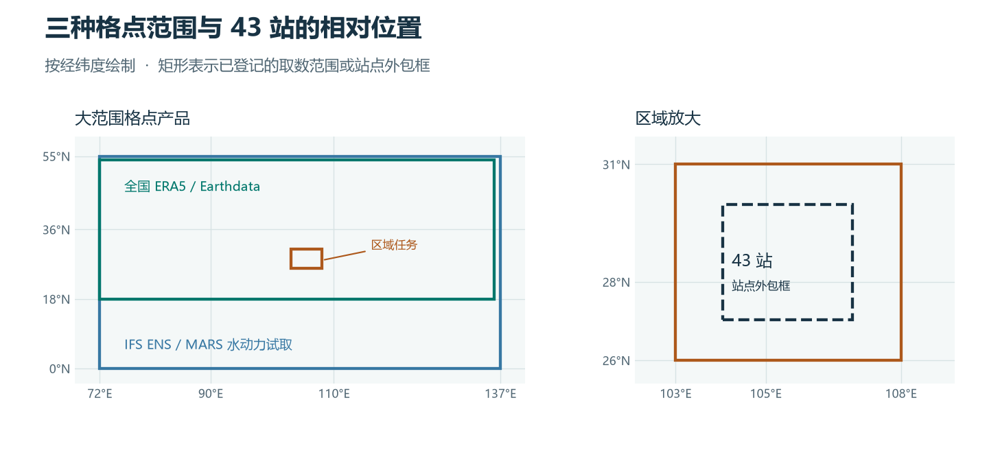

# 已有数据资产

先按用途找产品，再打开产品页核对变量、实际日期和存储路径。**资料盘点截至 2026 年 11 月 25 日。**

| 我想找什么 | 从哪里看 |
|---|---|
| 全国多年连续的气象、水热通量、土壤温度 | [GLDAS 与 MERRA-2 五个产品](reanalysis.md#gldas) |
| ECMWF、GFS、GEFS 或 TIGGE 不同起报的预报 | [天气预报与分析场](forecasts.md) |
| ERA5、ERA5-Land 已下载的小时包和区域压缩包 | [ERA5](reanalysis.md#era5) · [ERA5-Land](reanalysis.md#era5-land) |
| 直接用于观测、预报、再分析比较的 43 站数据 | [Predict 站点比较包](stations.md#predict-prepared) |
| CMFD、CRA40-Land、CLDAS、1 km 栅格或模型资料 | [区域驱动与研究库存](regional.md) |

## 哪些时段已经有数据

| 数据与范围 | 已有覆盖 | 要留意的缺口 |
|---|---|---|
| [GLDAS 全国](reanalysis.md#gldas) | 2019-12-31～2026-01-01，17,552 个三小时文件均有验收记录 | 相同日期的小区域副本采用单独的核验记录 |
| [MERRA-2 全国](reanalysis.md#m2i1nxasm) | 同期五个产品，各 2,194 个日文件，文件内逐小时 | 大气、通量、土温、辐射和近地面产品的变量各异 |
| [ERA5 单层](reanalysis.md#era5) | 全国任务已验 2019-12-31 全天；区域另有 2023 年 12 个 ZIP | 全国已验 1/74 包；区域包仍需核对内部小时和变量 |
| [ERA5-Land](reanalysis.md#era5-land) | 区域 2020–2025 年 288 个 ZIP 已通过压缩包检查；另有全国日样本 | 样本仅为 2019-12-31，区域各月内部覆盖待核 |
| [IFS ENS](forecasts.md#ifs-ens) | 2025-01-01～04-09 及 07-02，已核 200/730 次起报 | 中间有空档，可看逐日日历 |
| [MARS 水动力试取](forecasts.md#ifs-mars) | 2024 年 2 月和 12 月共 18 次起报、4 个文件块 | 试取覆盖两个短时段；区域历史 MARS 另列 |
| [Predict 43 站](stations.md#predict-prepared) | 2024 上半年，拼接主包有 727 个原生 6 小时时刻 | 时轴已建齐，部分产品、变量和站点时次有缺值 |

## 数据覆盖到哪里

| 页面中的范围名称 | 可核对的经纬度 |
|---|---|
| 全国裁剪（ERA5、Earthdata） | 72–136°E，18–54°N |
| IFS ENS、水动力试取 | 72–137°E，0–55°N |
| 区域预报常用请求框 | 103–108°E，26–31°N。旧库存中另有更小裁剪，见各副本 |
| 43 站 | 104.05–106.93°E，27.03–29.97°N。数据仅在站点上取值 |

## 怎样找到文件，怎样读日期

每个产品页列出**存储代号 / 相对路径**。例如，`predict-data / raw/ecmwf_ifs_ens` 指 `predict-data` 所映射磁盘根目录下的 `raw/ecmwf_ifs_ens`。已配置本机映射时，可运行 `python catalog.py locate --client workstation-fc01 --task ifs-ens-2025` 显示实际路径。MARS 试取使用 `python catalog.py locate --task hydrodynamics-2024`。[存储代号映射说明](../clients.md)

**数据时间**指气象资料代表的时段，预报默认标注起报时刻。**下载日期**采用能对应到该批文件的传输记录；只有盘点、验收或制作日期时单独标明。主表索引的 71 条研究资产及 CSV 的 14 条记录均有入口，重复登记的同一路径已合并展示。压缩备份、多产品共用同一文件的情况保留在对应产品下。[研究资产原表](../../catalog/research/clients/workstation-fc01.json) · [试取、准备包与历史位置原表](../../catalog/assets.csv)
