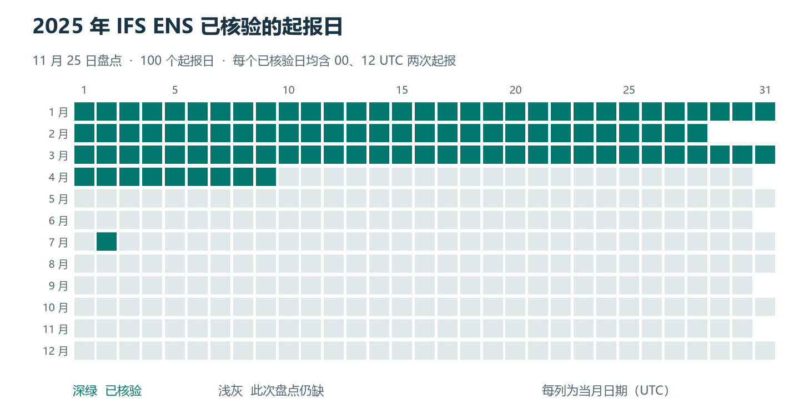

# 天气预报与分析场

[返回数据资产首页](README.md) · [IFS ENS 集合预报](#ifs-ens) · [IFS MARS 确定性预报](#ifs-mars) · [IFS Open Data 公开预报样例](#ifs-open) · [GFS 全球确定性预报](#gfs) · [GEFS 集合预报](#gefs) · [TIGGE 中国气象局预报](#tigge-cma) · [TIGGE 欧洲中心样例](#tigge-ecmf) · [TIGGE 美国中心样例](#tigge-kwbc) · [GDAS/FNL 分析与短时预报](#gdas-fnl)

## IFS ENS 集合预报

ECMWF 的 51 成员集合预报，用于比较同一次起报的不同可能结果。

| 项目 | 已登记的内容 |
|---|---|
| 数据时间 | 2025-01-01～04-09，以及 07-02，均含 00/12 UTC。11 月 25 日盘点已核 200/730 次起报（27.4%）。 |
| 空间范围 | 72–137°E、0–55°N，0.25°。 |
| 变量 | 2 米气温（0～72 小时，每 6 小时）和 6 小时累计降水（12 段）。控制成员 1 个、扰动成员 50 个。 |
| 下载日期 | 下载日期未登记。11 月 25 日 22:23 更新的是盘点进度。 |
| 来源与配置 | ECMWF / Dynamical · `IFS ENS 0.25°` · [获取与核验方法](../data-sources.md#ifs-ens) |

日历取自[11 月 25 日的盘点更新](https://github.com/LXN9WORKMODE0/DOWNLOAD/pull/1)。主分支客户端表仍是 11 月 24 日的 88 次快照，两次计数覆盖同一目录。

**保存位置与副本**

| 存储代号 / 根目录下的路径 | 格式与覆盖 | 核验依据 |
|---|---|---|
| `predict-data` / `raw/ecmwf_ifs_ens` | NetCDF4 · 按 11 月 25 日盘点，2025-01-01～04-09、07-02 各两个时次，范围同上。 | **已核验**。200 次起报通过缺字段记录检查，样例另查成员、时效和网格。 |

## IFS MARS 确定性预报

ECMWF 业务预报档案。这里同时保存水动力试取和早期区域档案。

| 项目 | 已登记的内容 |
|---|---|
| 数据时间 | 水动力试取覆盖 2024-02-01、02-03～06、12-01、12-03～06 的部分起报，共 18 次。区域 oper/scda 保存 2023–2024 年部分批次。 |
| 空间范围 | 水动力试取 72–137°E、0–55°N，0.25°。区域档案请求 103–108°E、26–31°N。 |
| 变量 | 试取已核 9 项：2 米气温、露点，10 米东西风、南北风，地表气压、总降水、向下短波和长波辐射、总云量。区域档案有独立选参。 |
| 下载日期 | 2026-11-24（北京时间）：3 个试取块有成功传输计时；2 月 1 日单起报块当天复核，首次下载日期待查。区域档案下载日未登记。 |
| 来源与配置 | ECMWF · `IFS operational archive (MARS)` · [获取与核验方法](../data-sources.md#ifs-mars) |

**保存位置与副本**

| 存储代号 / 根目录下的路径 | 格式与覆盖 | 核验依据 |
|---|---|---|
| `predict-data` / `raw/ecmwf_archive` | GRIB2 · 2023–2024 区域 oper/scda 档案，26–31°N, 103–108°E | **已抽样**。数据库完成 762 批；有些批次在另一个存储位置，完整覆盖待逐批核对 |
| `forecast-drive` / `ecmwf/data/raw/ecmwf_archive/oper` | GRIB2 · 2023–2024，382 个按日期命名的批次 | **已清点**。本机可访问；区域任务的 762 个已登记批次全部在可见盘找到大小匹配且首尾标识正常的文件 此路径也见 2026-10-10 历史清单。 |
| `forecast-drive` / `ecmwf/data/raw/ecmwf_archive/scda` | GRIB2 · 2023–2024，380 个按日期命名的批次 | **已清点**。本机可访问；区域任务的 762 个已登记批次全部在可见盘找到大小匹配且首尾标识正常的文件 此路径也见 2026-10-10 历史清单。 |
| `forecast-history` / `ecmwf_ifs` | GRIB · 2020-01 的 oper/scda 瞬时及累计样例，另有测试文件 | **已清点**。变量、空间覆盖及可用时效待解码 |
| `ifs-pilot` / `full_range/hydrodynamics/surface/2024/tape_pilot_chunks/2024020100_2024020100.grib` | GRIB · 2024-02-01 00 UTC | **试取已验**。1 次起报、477 场。11 月 24 日复核已有文件。 |
| `ifs-pilot` / `full_range/hydrodynamics/surface/2024/tape_pilot_chunks/2024020300_2024020612.grib` | GRIB · 2024-02-03 00 UTC ～ 2024-02-06 12 UTC | **试取已验**。8 次起报、3816 场。本地计时日志登记传输于 2026-11-24。 |
| `ifs-pilot` / `full_range/hydrodynamics/surface/2024/tape_pilot_chunks/2024120100_2024120100.grib` | GRIB · 2024-12-01 00 UTC | **试取已验**。1 次起报、657 场。本地计时日志登记传输于 2026-11-24。 |
| `ifs-pilot` / `full_range/hydrodynamics/surface/2024/tape_pilot_chunks/2024120300_2024120612.grib` | GRIB · 2024-12-03 00 UTC ～ 2024-12-06 12 UTC | **试取已验**。8 次起报、5256 场。本地计时日志登记传输于 2026-11-24。 |

## IFS Open Data 公开预报样例

ECMWF 全球业务预报样例，保存原始 GRIB2 和清单。

| 项目 | 已登记的内容 |
|---|---|
| 数据时间 | 2026-08-12 样例，起报与时效的逐项覆盖待核。 |
| 空间范围 | 记录为全球源网格。 |
| 变量 | 请求配置含 10 米风、2 米气温与露点、地表和海平面气压、降水、向下和净短长波辐射、云量、径流及表皮温度。单个样例的实际字段尚待解码。 |
| 下载日期 | 未登记。 |
| 记录日期 | 2026-11-24 客户端库存盘点。 |
| 来源与配置 | ECMWF · `IFS Open Data` · [获取与核验方法](../data-sources.md#predict) |

**保存位置与副本**

| 存储代号 / 根目录下的路径 | 格式与覆盖 | 核验依据 |
|---|---|---|
| `predict-data` / `raw/ecmwf_ifs/20260812` | GRIB2 + JSON · 2026-08-12 样例，全球源网格 | **已清点**。发现文件与 SHA-256 清单 |

## GFS 全球确定性预报

NOAA GFS 历史区域裁剪、归档及独立样例。

| 项目 | 已登记的内容 |
|---|---|
| 数据时间 | 历史目录见 2020–2025 年；ZIP 成员名从 2021-03-22 至 2025-12-31，有缺期。另有 2026-08-12 样例。 |
| 空间范围 | 历史区域请求 103–108°E、26–31°N，产品 0.25°。归档副本的实际网格待核。 |
| 变量 | 共享请求字段包括风、气温、露点、气压、短长波辐射、云量和地表热通量等。字段代码 UGRD、VGRD、TMP、DPT、PRES、PRMSL、DSWRF、USWRF、DLWRF、ULWRF、TCDC、LHTFL、SHTFL、WATR。各归档的实际变量待核。 |
| 下载日期 | 未登记。 |
| 记录日期 | 2026-11-24 客户端库存盘点。 |
| 来源与配置 | NOAA NCEP / NSF NCAR GDEX · `GFS 0.25°` · [获取与核验方法](../data-sources.md#predict) |

**保存位置与副本**

| 存储代号 / 根目录下的路径 | 格式与覆盖 | 核验依据 |
|---|---|---|
| `predict-data` / `raw/gfs_rda` | NetCDF · 2020–2025 起报目录，26–31°N, 103–108°E | **已抽样**。两处可见目录合计抽查 18 项，12 项的大小和文件头匹配。目录日期跨度内仍可能缺期。 |
| `predict-data` / `raw/gfs/20260812` | GRIB2 · 2026-08-12 样例，区域请求 26–31°N, 103–108°E | **已清点**。独立于历史任务 |
| `forecast-drive` / `gfs/data/raw` | NetCDF / GRIB · 本机可访问，年度可从实际文件清单复核 | **已清点**。旧解包位置 |
| `forecast-drive` / `gfs.zip` | ZIP · ZIP 成员起报日 2021-03-22 至 2025-12-31 | **已清点**。2021–2025 共 466,192 个不同起报×时效；15,060 个成员大小匹配当前 SQLite 完成记录。历史版本差异及压缩成员内容待核。 此路径也见 2026-10-10 历史清单。 |
| `research-volume` / `GFS` | TAR · 7 个变量分包，文件名 2023012500，覆盖待核 | **已清点**。仅保存 |

## GEFS 集合预报

NOAA 集合预报区域 GRIB，按起报、成员和时效组织。

| 项目 | 已登记的内容 |
|---|---|
| 数据时间 | 现盘目录见 2020、2021、2023–2025 年。另一个副本登记 543 个起报日；跨盘重叠与缺口待核。 |
| 空间范围 | 区域请求 103–108°E、26–31°N，源产品 0.5°。 |
| 变量 | 半年比较包采用控制成员的气温、露点、10 米风分量和地表气压。完整归档的字段清单待解码。任务配置为 31 成员、0～384 小时每 6 小时。 |
| 下载日期 | 未登记。 |
| 记录日期 | 2026-11-24 客户端库存盘点。 |
| 来源与配置 | NOAA NCEP · `GEFS 0.5° pgrb2ap5 / pgrb2bp5` · [获取与核验方法](../data-sources.md#predict) |

**保存位置与副本**

| 存储代号 / 根目录下的路径 | 格式与覆盖 | 核验依据 |
|---|---|---|
| `predict-data` / `raw/gefs` | GRIB2 + .complete.json · 可见起报目录 2020、2021、2023–2025，26–31°N, 103–108°E | **已抽样**。按起报 × 成员逐盘核实 65 时效和字节，按日期目录不能判断完整 |
| `forecast-drive` / `gefs/data/raw/gefs` | GRIB2 · 543 个起报日目录，2024 有 357 个，2025-01-01 至 07-05 有 186 个 | **已清点**。缺期和与其他盘的重叠待核 此路径也见 2026-10-10 历史清单。 |

## TIGGE 中国气象局预报

TIGGE 档案中的 CMA 产品，含分日文件、解包目录和 ZIP 副本。

| 项目 | 已登记的内容 |
|---|---|
| 数据时间 | 跨盘匹配 2023 年 306 批、2024 年 343 批。ZIP 单独含 333 个 2024 年日期文件，各副本可能重叠。 |
| 空间范围 | 区域请求 103–108°E、26–31°N，0.5°。 |
| 变量 | 配置中有气温、露点、风、气压、降水、云量、辐射和热通量等。2024 上半年已整理的 CMA 控制成员可用气温、风、地表气压，缺露点及相对湿度。 |
| 下载日期 | 未登记。 |
| 记录日期 | 2026-11-24 客户端库存盘点。 |
| 来源与配置 | ECMWF ECDS / CMA · `TIGGE cma` · [获取与核验方法](../data-sources.md#predict) |

**保存位置与副本**

| 存储代号 / 根目录下的路径 | 格式与覆盖 | 核验依据 |
|---|---|---|
| `predict-data` / `raw/tigge/cma` | GRIB2 · 2023 年部分 306 个、2024 年部分 10 个，区域请求 26–31°N、103–108°E | **已清点**。2025 有已生成任务，文件完整覆盖待核 |
| `forecast-drive` / `tigge.zip` | ZIP · 333 个 CMA 日期文件，2024-01-01 至 12-31，日期不连续 | **已检压缩包**。333 个 CMA 成员均通过 ZIP CRC，且按日期与当前 SQLite 完成项的文件大小匹配。逐报文语义待核。 此路径也见 2026-10-10 历史清单。 |
| `forecast-history` / `cma_geps` | GRIB · 2 个 GRIB 临时文件，覆盖待核 | **已清点**。临时文件不计入进度 |
| `forecast-drive` / `tigge/data/raw/tigge/cma` | GRIB2 · 2024 年部分 333 个日期文件 | **已清点**。按文件名清点；同年份部分另存 predict-data |

## TIGGE 欧洲中心样例

TIGGE 中心代码 ecmf 的历史预报样例。

| 项目 | 已登记的内容 |
|---|---|
| 数据时间 | 2024 年部分样例，具体日期与时效待核。 |
| 空间范围 | 登记范围 103–108°E、26–31°N。 |
| 变量 | 此来源样例的实际字段未登记，需查原请求或 GRIB。 |
| 下载日期 | 未登记。 |
| 记录日期 | 2026-11-24 客户端库存盘点。 |
| 来源与配置 | ECMWF ECDS / ECMWF · `TIGGE ecmf` · [获取与核验方法](../data-sources.md#predict) |

**保存位置与副本**

| 存储代号 / 根目录下的路径 | 格式与覆盖 | 核验依据 |
|---|---|---|
| `predict-data` / `raw/tigge/ecmf` | GRIB2 · 2024 历史样例，26–31°N, 103–108°E | **已清点**。仅存储，旧队列已归档为历史 |

## TIGGE 美国中心样例

TIGGE 中心代码 kwbc 的历史预报样例。

| 项目 | 已登记的内容 |
|---|---|
| 数据时间 | 2024 年部分样例，具体日期与时效待核。 |
| 空间范围 | 登记范围 103–108°E、26–31°N。 |
| 变量 | 此来源样例的实际字段未登记，需查原请求或 GRIB。 |
| 下载日期 | 未登记。 |
| 记录日期 | 2026-11-24 客户端库存盘点。 |
| 来源与配置 | ECMWF ECDS / NCEP · `TIGGE kwbc` · [获取与核验方法](../data-sources.md#predict) |

**保存位置与副本**

| 存储代号 / 根目录下的路径 | 格式与覆盖 | 核验依据 |
|---|---|---|
| `predict-data` / `raw/tigge/kwbc` | GRIB2 · 2024 历史样例，26–31°N, 103–108°E | **已清点**。仅存储，旧队列已归档为历史 |

## GDAS/FNL 分析与短时预报

NOAA 分析及短时预报 GRIB2，配有报文索引。

| 项目 | 已登记的内容 |
|---|---|
| 数据时间 | 文件名从 2020-01-01 00 至 2025-01-01 00。14,596 个 GRIB2 和等量索引，f00/f03，边界时次及缺口待核。 |
| 空间范围 | 文件名标记产品 0.25°，本地文件的经纬度边界待解码。 |
| 变量 | 本地库存尚无解码后的字段清单。 |
| 下载日期 | 未登记。 |
| 记录日期 | 2026-11-24 客户端库存盘点。 |
| 来源与配置 | NOAA NCEP / NSF NCAR GDEX · `GDAS/FNL 0.25°` · [获取与核验方法](../data-sources.md#gdas) |

**保存位置与副本**

| 存储代号 / 根目录下的路径 | 格式与覆盖 | 核验依据 |
|---|---|---|
| `research-volume` / `gdas` | GRIB2 + IDX · 2020-01-01 00 至 2025-01-01 00，14,596 个 GRIB2 与等量 .idx；以文件名为准 | **已清点**。f00/f03，临界时次和缺期需按原目标对照；变量和实际空间覆盖待解码 |
